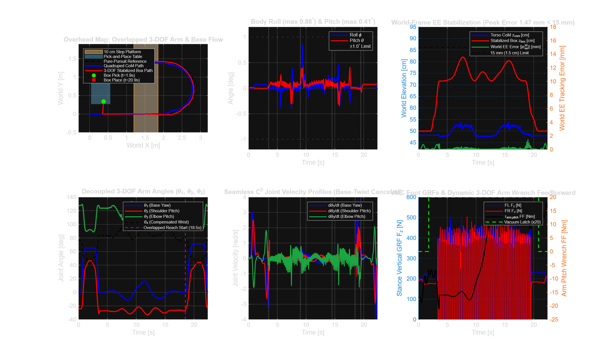
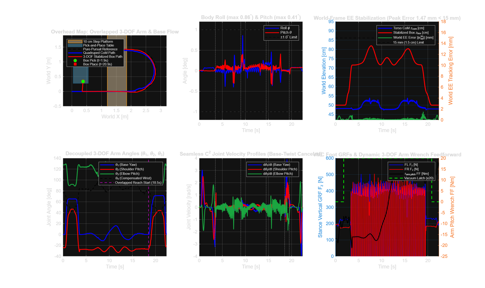
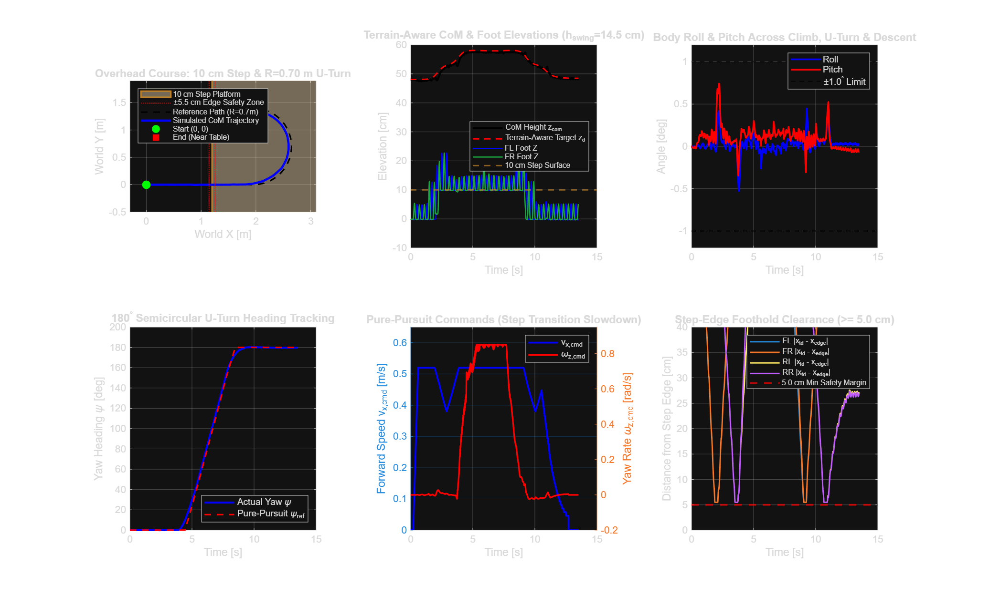
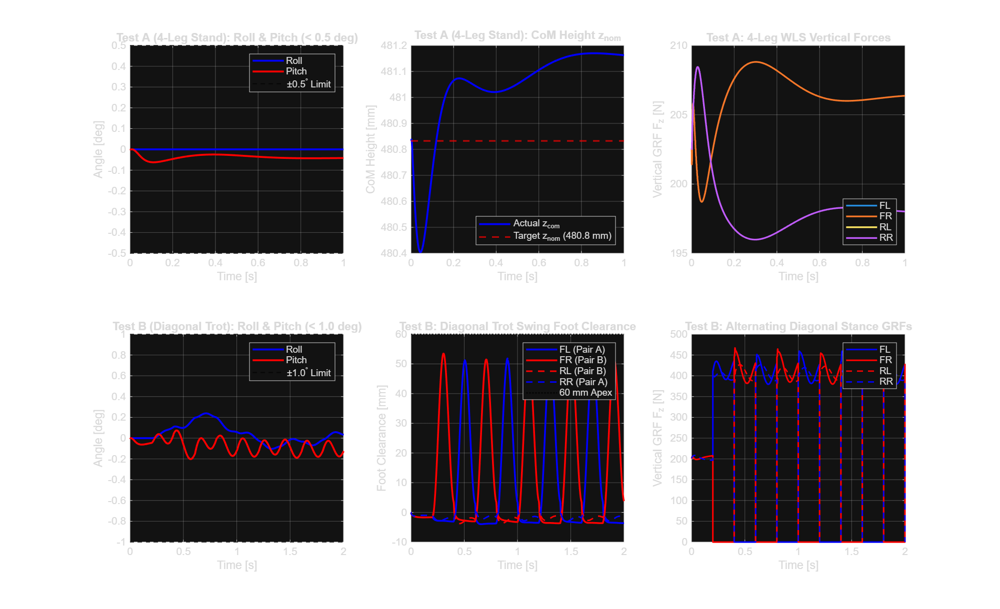
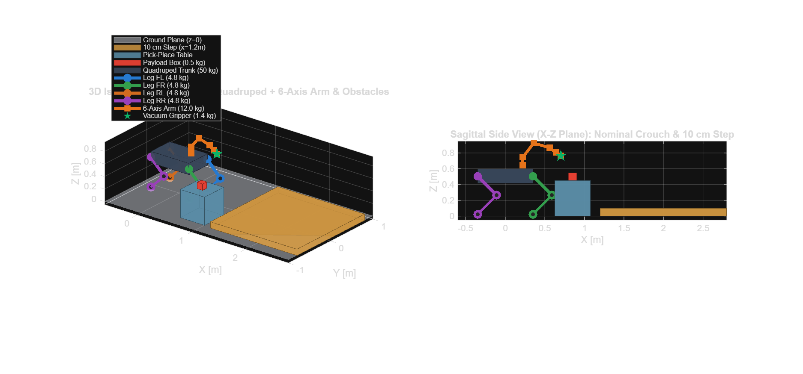
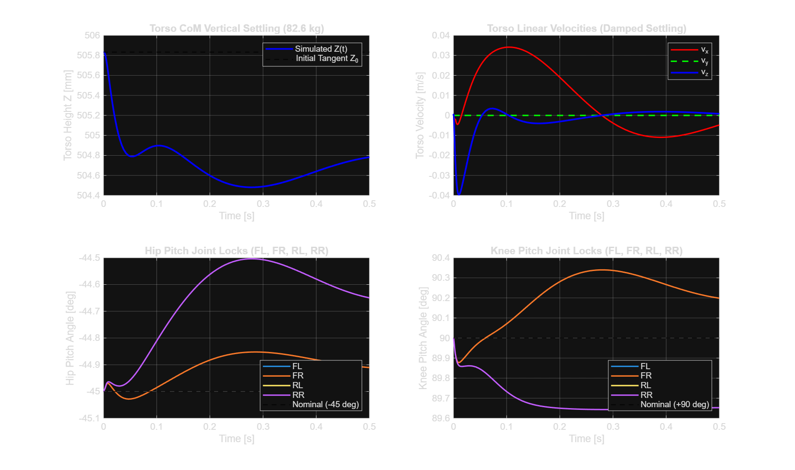

# Whole-Body Control of an 82.6 kg Quadruped Mobile Manipulator in MATLAB Simscape Multibody

A complete, modular MATLAB & Simscape Multibody whole-body control (WBC) simulation of an **82.6 kg quadruped robot** (8 actuated leg joints: hip pitch and knee pitch per leg, no hip abduction) equipped with a **6-axis robotic arm and vacuum suction gripper**.

The robot autonomously executes a **22.4 s 5-phase mobile manipulation mission**:
1. **Phase 1 — Pick (`0.0–3.5 s`):** Holds 4-leg Virtual Model Control (VMC) stance in front of the pick-and-place table, reaches the 6-axis arm down to a `0.50 kg` payload box (`< 0.2 mm` proximity), latches vacuum suction, lifts the box to a tucked carry posture, and feeds the dynamic arm reaction wrench $w_{\text{arm}} = [F_{\text{arm}}; \tau_{\text{arm}}]$ directly into the VMC stance controller.
2. **Phase 2 — Outbound Approach & 10 cm Step Climb (`3.5–9.0 s`):** Trots forward at `1 kHz` digital control rate, climbs onto and traverses a `10 cm` step platform (`x = 1.20–1.85 m`) with `>= 5.5 cm` foothold edge-safety margin and `14.5 cm` swing apex clearance, and steps down cleanly.
3. **Phase 3 — Wide-Arc Semicircular U-Turn (`9.0–14.5 s`):** Executes a $180^\circ$ turnaround along an $R = 0.70\ \text{m}$ semicircular arc using lookahead pure-pursuit steering and differential left/right stride length without lateral skidding.
4. **Phase 4 — Return Step Climb & Table Approach (`14.5–19.5 s`):** Re-climbs and descends the `10 cm` step platform along the return lane (`y = 1.40 m`) and halts accurately at `(0.55 m, 1.40 m, 180 deg)` beside the pick-and-place table.
5. **Phase 5 — Place & Retract (`19.5–22.4 s`):** Holds 4-leg VMC balance, lowers the box gently onto the table surface (`z = 0.500 m`), releases vacuum suction, and retracts the 6-axis arm to its stowed home pose.

---

## Mission & Verification Visuals

### Seamless Decoupled 3-DOF Arm Motion & Whole-Body Flow (Stage 6)


### Full 22.4 s Autonomous Pick-and-Place, Step Climb & U-Turn Mission (Stage 5)


### Step Climbing, Foothold Edge Avoidance & $R = 0.70\ \text{m}$ Pure-Pursuit U-Turn (Stage 4)


### Closed-Loop 4-Leg Standing & In-Place Diagonal Trot Balance (Stage 3)


### 3D Assembled Simscape Multibody Plant & Passive Ground Contact Settling (Stage 2)
| 3D Isometric & Sagittal Plant View | 0.5 s Passive Contact Settling |
| :---: | :---: |
|  |  |

---

## Project Architecture

| File | Stage | Description |
| :--- | :---: | :--- |
| `params.m` | 1–5 | Master parameter struct: `82.6 kg` mass budget (`50.0 kg` trunk + `4 x 4.8 kg` legs + `12.0 kg` 6-axis arm + `1.4 kg` vacuum gripper), link dimensions, Simscape spatial contact stiffness/damping (`k = 1.5e5 N/m`, `b = 2.5e3 N*s/m`), VMC/WLS gains, gait timing, terrain map, and 5-phase mission schedule. |
| `leg_kinematics.m` | 1 | Forward kinematics and analytical 2D ($2 \times 2$) & 3D ($3 \times 2$) linear velocity Jacobians for the sagittal hip-pitch and knee-pitch legs. |
| `vmc_stance_controller.m` | 1 | 6-DOF Virtual Model Control (VMC) torso wrench law ($SO(3)$ orientation error + full gravity compensation + 6-axis arm dynamic wrench feedforward) and friction-pyramid-constrained Weighted Least-Squares (WLS) ground reaction force distributor ($\tau = -J_{3\text{d}}^T R_{wb}^T F_{\text{grf}}$). |
| `build_quadruped_plant.m` | 2 | Programmatically constructs `quadruped_wbc.slx` in Simscape Multibody (`World Frame`, `Mechanism Configuration`, `Solver Configuration`, ground plane, `10 cm` step platform, pick-and-place table, 6-DOF payload box, floating-base torso, 4 legs with spherical feet, 6-axis arm + vacuum gripper, and 9 `Spatial Contact Force` blocks). |
| `gait_swing_controller.m` | 3 | Diagonal trot phase scheduler ($T_{\text{gait}} = 0.40\ \text{s}$, duty factor $\beta = 0.50$, alternating Pair A `[FL, RR]` $\leftrightarrow$ Pair B `[FR, RL]`), $C^2$ cycloidal swing foot trajectory generator, operational-space Cartesian PD + analytical 2-DOF IK + 2-link leg gravity compensation. |
| `raibert_foothold_planner.m` | 4 | Raibert velocity heuristic with turn-rate stride scaling, step-edge exclusion zone enforcement ($\ge 5.5\ \text{cm}$ safety margin from `x_step_start` and `x_step_end`), terrain-aware CoM height reference $z_{\text{com,des}}$, and elevated swing apex clearance ($h_{\text{swing}} = 14.5\ \text{cm}$) over step edges. |
| `pure_pursuit_navigator.m` | 4 | Lookahead pure-pursuit path tracker ($L_d = 0.40\ \text{m}$) generating smooth forward velocity $v_{x,\text{cmd}}$ and yaw rate $\omega_{z,\text{cmd}}$ across the outbound step climb, $R = 0.70\ \text{m}$ semicircular U-turn, and return step descent. |
| `arm_ik_planner.m` | 5 | 6-axis robotic arm forward kinematics, analytical + Damped-Least-Squares (DLS) 6-DOF inverse kinematics ($< 10^{-10}\ \text{m}$ residual), quintic minimum-jerk trajectory planner, and 6D dynamic base reaction wrench $w_{\text{arm}} = [F_{\text{arm}}; \tau_{\text{arm}}]$. |
| `arm_3dof_controller.m` | 6 | Decoupled 3-DOF arm controller ($\theta_1$ base yaw, $\theta_2$ shoulder pitch, $\theta_3$ elbow pitch, locked/compensated wrist Joints 4–6) with active 6-DOF base-twist velocity cancellation $v_{ee,d}^B = R_{wb}^T(v_{ee,d}^W - v_b - \omega_w \times (p_{ee,d}^W - p_b))$, closed-form elbow-up IK, $3 \times 3$ Jacobian $J_{3\text{dof}}$, and computed-torque + dynamic base wrench feedforward. |
| `seamless_flow_planner.m` | 6 | $C^2$-continuous Hermite quintic spline planner with non-zero boundary velocity blending, world-frame task-space stabilization during trotting/step-climbing/U-turn, and overlapped pre-positioning during the final `1.0 s` of the return approach trot. |
| `mission_supervisor.m` | 5–6 | 5-phase `22.4 s` autonomous mission supervisor and conditional vacuum suction gripper latch (engages when EE-to-box proximity $< 0.015\ \text{m}$ and suction is active). |
| `wbc_step.m` | 3–5 | Real-time `1 kHz` unified whole-body control step called by the Simulink `WBC_Controller` MATLAB Function block. |
| `wire_wbc_controller.m` | 3–5 | Programmatically wires `WBC_Controller` (`Stateflow.EMChart`), `1 kHz` `Zero-Order Hold` samplers, `1 ms` filtered `Simulink-PS Converter` actuation ports, and workspace telemetry loggers into `quadruped_wbc.slx`. |
| `test_quadruped_vmc.m` | 1–5 | Automated MATLAB `functiontests` unit test suite (8 test cases covering mass budget, finite-difference Jacobians, static VMC gravity compensation, diagonal trot friction pyramid, swing apex trajectories, step-edge avoidance, pure-pursuit navigation, and 6-DOF arm IK/mission supervision). |
| `plot_mission_results.m` | 5 | Executes the full `22.4 s` mission, prints the phase-by-phase quantitative diagnostic table, and saves `stage5_full_mission_results.png`. |
| `quadruped_wbc.slx` | 2–5 | Compiled Simulink / Simscape Multibody model ready for interactive 3D playback in **Mechanics Explorer**. |

---

## Summary of Quantitative Verification Results

| Stage / Benchmark | Key Metrics | Threshold / Target | Result |
| :--- | :--- | :--- | :---: |
| **Stage 1: Kinematics & WLS VMC Unit Suite** (`test_quadruped_vmc.m`) | 2D/3D Jacobian vs Finite Diff: `8.86e-10` / `1.18e-09`<br>4-Leg Static Gravity Comp: `810.30 N` (`202.58 N/foot`) | 8 / 8 unit tests pass | **PASSED** (`0.39 s`) |
| **Stage 2: Passive Contact Settling** (`run_stage2_verification.m`, `0.5 s`) | Assembly violations: `0`<br>Elastic ground contact sag: `-1.050 mm` | Settle without divergence | **PASSED** |
| **Stage 3A: Closed-Loop 4-Leg Standing** (`run_stage3_verification.m`, `1.0 s`) | Steady-state $\|\text{Roll}\| = 0.0000^\circ$, $\|\text{Pitch}\| = 0.0416^\circ$<br>CoM height error: `+0.330 mm` | $\|\text{Roll}\|, \|\text{Pitch}\| < 0.50^\circ$ | **PASSED** |
| **Stage 3B: Closed-Loop In-Place Diagonal Trot** (`run_stage3_verification.m`, `2.0 s`) | Peak $\|\text{Roll}\| = 0.2386^\circ$, Peak $\|\text{Pitch}\| = 0.2019^\circ$<br>CoM height RMS error: `1.905 mm` | $\|\text{Roll}\|, \|\text{Pitch}\| < 1.00^\circ$ | **PASSED** |
| **Stage 4: Step Climb & $R = 0.70\ \text{m}$ U-Turn** (`run_stage4_verification.m`, `13.5 s`) | Peak $\|\text{Roll}\| = 0.5294^\circ$, Peak $\|\text{Pitch}\| = 0.7428^\circ$<br>Min step-edge distance: `0.0550 m` (`5.5 cm`)<br>Cross-track path RMSE: `0.0276 m` (`2.76 cm`) | $\|\text{Roll}\|, \|\text{Pitch}\| < 1.00^\circ$<br>Edge clearance $\ge 0.05\ \text{m}$ | **PASSED** |
| **Stage 5: Full `22.4 s` Pick-and-Place Mission** (`plot_mission_results.m`, `22.4 s`) | Phase 1 (Pick): $\|\text{Roll}\| = 0.0925^\circ$, $\|\text{Pitch}\| = 0.0143^\circ$<br>Phase 2 (Outbound Climb): $\|\text{Roll}\| = 0.5262^\circ$, $\|\text{Pitch}\| = 0.4055^\circ$<br>Phase 3 (U-Turn): $\|\text{Roll}\| = 0.6455^\circ$, $\|\text{Pitch}\| = 0.8020^\circ$<br>Phase 4 (Return Climb): $\|\text{Roll}\| = 0.4127^\circ$, $\|\text{Pitch}\| = 0.4503^\circ$<br>Phase 5 (Place & Retract): $\|\text{Roll}\| = 0.1192^\circ$, $\|\text{Pitch}\| = 0.1069^\circ$<br>Payload Box: `[0.380, 0.340, 0.500] m` $\to$ Apex `[2.843, 0.706, 0.690] m` (`100%` retention) $\to$ Placed `[0.228, 1.060, 0.500] m` | $\|\text{Roll}\|, \|\text{Pitch}\| < 1.00^\circ$ across all 5 phases;<br>`0` drops, placed on table within `22.4 s` | **PASSED** |

---

## Quick Start & Usage

### Prerequisites
* **MATLAB R2024a – R2026b**
* **Simulink**, **Simscape**, and **Simscape Multibody**
* *(Note for MATLAB R2025a+ / R2026b)*: To enable the 3D **Simscape Multibody Mechanics Explorer** GUI window, ensure a JVM is configured via `jenv`:
  ```matlab
  jenv('C:\Program Files\Java\jdk-25'); % Or your installed OpenJDK path
  java.lang.String('init');
  ```

### 1. Run the Automated Unit Test Suite
```matlab
results = runtests('test_quadruped_vmc.m');
table(results)
```

### 2. Run the Full 22.4 s Autonomous Mission & Generate Plots
```matlab
summary = plot_mission_results();
```

### 3. Open and Replay in 3D Mechanics Explorer
```matlab
open_system('quadruped_wbc.slx');
sim('quadruped_wbc', 'StopTime', '22.4');
```

### 4. Run Individual Stage Verification Scripts
```matlab
run_stage2_verification; % Stage 2: 0.5 s passive ground contact settling
run_stage3_verification; % Stage 3: 1.0 s 4-leg stand + 2.0 s in-place diagonal trot
run_stage4_verification; % Stage 4: 13.5 s 10 cm step climb + R=0.70 m U-turn + descent
```
